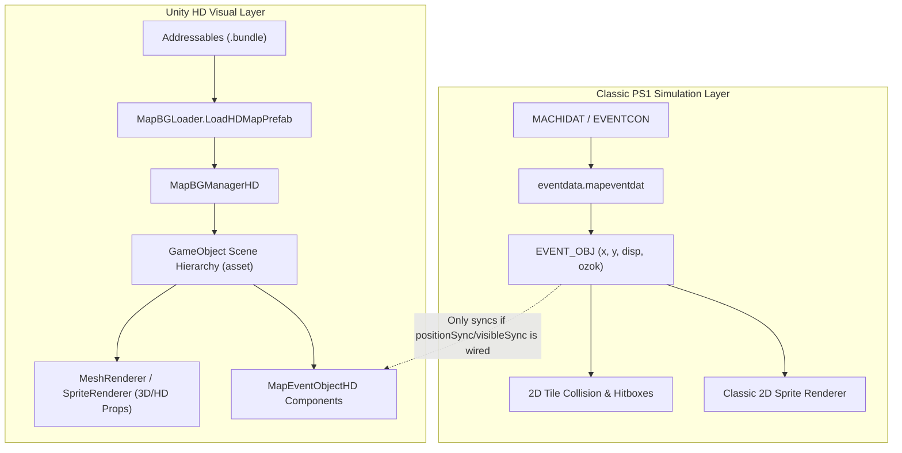

# Suikoden HD Remaster: HD Visual Layer vs. 2D Map Entity Synchronization

## 1. Problem Overview: "Ghost" HD Textures

When modifying map entities in Suikoden II via `MACHICON.EventInit` or map JSONs (`vd06.json`, `vg15.json`, `vg02.json`):
- Changing an object's position `(x, y)` moves its 2D collision and classic sprite.
- Setting `"disp": 0` and `"ozok": 0` completely removes the 2D collision box and classic sprite (allowing the player to walk or warp through).
- **The Issue:** The high-definition (HD) remaster visual—whether a 3D prop mesh or high-res texture—often remains visible on screen at its original coordinate. This leaves a visual "ghost" rock or boulder that the player can pass right through, or causes moved objects (like the Cave of the Wind wind-blocking boulders) to lack their HD textures at their new locations.

---

## 2. Remaster Architecture: Dual-Engine Pipeline

The Remaster does not use a single unified rendering pipeline for environments. It runs two systems side-by-side:



1. **PS1 Simulation Engine (`GSD2::EVENTCON`, `MACHIDAT`, `EVENT_OBJ`)**:
   - Manages player movement, collision tiles (`ozok`), interaction scripts, and PS1-era 2D tilemaps.
   - Setting `EVENT_OBJ.disp = 0` only informs this 2D engine that the actor/device should not spawn its classic sprite or register collision.

2. **Unity HD Visual Engine (`GSD2::MapBGManagerHD`, `GSDShare::MapEventObjectHD`)**:
   - Loads standalone Unity Prefabs from Addressables bundles (`gsd2-hd-map-{mapId}_{mno}`).
   - Contains high-resolution background paintings (e.g. 7680x7680 base textures) and modular 3D/HD prop `GameObject`s (e.g., rock models and sprite overlays).
   - Because the HD prefabs are separate Unity hierarchies, modifying 2D memory pointers during `EventInit` does not automatically toggle or transform the Unity HD renderers unless explicit synchronization components exist and are triggered.

---

## 3. Why Mod 17 Included ~60 MB of Bundle Files

Inspection of faospark's original Nexus Mod 17 (`Open Paths Mod`) revealed why it contained 5 Unity `.bundle` files (`82c9e76f...`, `b0a33fe4...`, etc.):

- In **Tinto Mines** (`vg15`, `vg02`), the actual rock blockage props are:
  - `t_vg02_02_obj_rock01` (Tinto Mining City, Room 2)
  - `t_vg15_00_obj_rock01` (Tinto Mines Tunnel, Room 0)
  - Note: In Unity's scene hierarchy (`bgManagerHD/vg15_00(Clone)/object/Rock`), Unity instantiates multiple duplicated copies of `t_vg15_00_obj_rock01`:
    - `t_vg15_00_obj_rock01` (instance 0)
    - `t_vg15_00_obj_rock01 (1)` (instance 1)
    - `t_vg15_00_obj_rock01 (2)` (instance 2)
    All instances must be normalized by stripping `\s*\(\d+\)` so all copies are hidden.
  - Note: `t_vg15_00_obj_rock02` (cave archway) and `t_vg15_00_obj_rock03` (cave walls) are permanent environmental geometry and must NOT be hidden.
- Because `disp: 0` did not hide the Unity visual, faospark extracted the bundles and **blanked out the texture alpha channels** (e.g., `t_vg15_00_obj_rock01.png` was edited to 100% transparency with alpha 0).
- Distributing raw modified `.bundle` files works, but has major downsides:
  - Prone to breaking whenever Konami updates or patches the game.
  - Large download size (~60 MB vs ~25 KB DLL).
  - Can clash with other mods editing the same bundles.

---

## 4. Technical Solutions in Code (Zero Bundle Replacements)

Because BepInEx runs natively inside Unity's IL2CPP runtime, we can resolve both moved and hidden HD objects dynamically in memory:

### Approach A: Unity Scene Graph Disabling (`GameObject.SetActive` / `Renderer.enabled`)
Directly locate the HD prop GameObjects when the room loads and disable their rendering:
- **Hook Point:** `MapBGManagerHD.SetMap` or postfix of `MapBGLoader.LoadHDMapPrefab`.
- **Implementation:**
  ```csharp
  // When entering vg15 room 0:
  var hdRoot = MapBGManagerHD.Instance?.asset;
  if (hdRoot != null)
  {
      // Find child renderers by name
      foreach (var renderer in hdRoot.GetComponentsInChildren<Renderer>(true))
      {
          string name = renderer.gameObject.name;
          if (name.Contains("rock01") || name.Contains("rock02") || name.Contains("rock03"))
          {
              renderer.enabled = false;
          }
      }
  }
  ```
- **Advantages:** Instant, clean, zero bundle file footprint, and completely reversible at runtime.

---

### Approach B: `MapEventObjectHD` Component Synchronization
For objects that need to move (such as Cave of the Wind boulders in `vd06`):
- `MapBGManagerHD` maintains a collection of `MapEventObjectHD`:
  - `public int objID` (Object index matching `eventobj[i]`)
  - `public int eventMapNo` (Room index)
  - `public bool positionSync`
  - `public bool visibleSync`
  - `public void SetPosition(Vector2 pos, bool isVisible, bool isSetFromInitEvent = false)`
- **Implementation:**
  ```csharp
  var eventObjs = MapBGManagerHD.Instance?.eventObjects;
  if (eventObjs != null)
  {
      for (int i = 0; i < eventObjs.Count; i++)
      {
          var hdObj = eventObjs[i];
          if (hdObj.eventMapNo == 8 && hdObj.objID == 1)
          {
              // Update position in Unity space
              hdObj.SetPosition(new Vector2(26, 23), true, true);
          }
      }
  }
  ```
- **Advantages:** Uses the Remaster's native sync pipeline, ensuring lighting, shaders, and animations track properly.

---

### Approach C: In-Memory Texture2D Blanking
If a prop's texture is shared across a mesh that cannot easily be detached from the scene hierarchy:
- Locate the loaded `Texture2D` in memory via `UnityEngine.Resources.FindObjectsOfTypeAll<Texture2D>()`.
- Call `texture.SetPixels32(transparentPixels)` and `texture.Apply()`.
- **Advantages:** Dynamically achieves the exact same result as faospark's modified `.bundle` files without altering a single file on disk.

---

## 5. Comparison Matrix

| Solution | Best For | Implementation Complexity | Memory / Disk Impact | Mod Compatibility |
|---|---|---|---|---|
| **A. GameObject Disabling** | Rock piles, barrier props (`vg15`, `vg02`) | Low (scan child names on load) | Zero disk, <1ms CPU | 100% update-proof |
| **B. MapEventObjectHD Sync** | Moveable boulders (`vd06`) | Medium (hook HD map load) | Zero disk, Native Unity calls | 100% update-proof |
| **C. In-Memory Texture Blanking** | Props baked into shared materials | Medium (texture pixel swap) | Zero disk, dynamic in RAM | 100% update-proof |
| **Vanilla Bundle Overwrite** | Fallback / Manual modding | Very High (repack Addressables) | ~60 MB disk download | Easily broken by updates |

